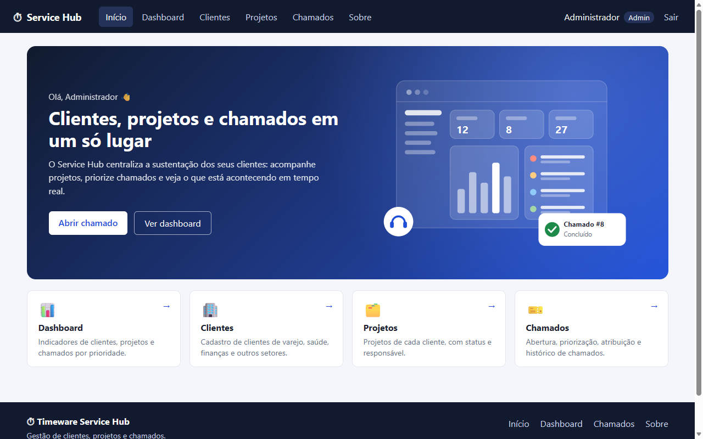
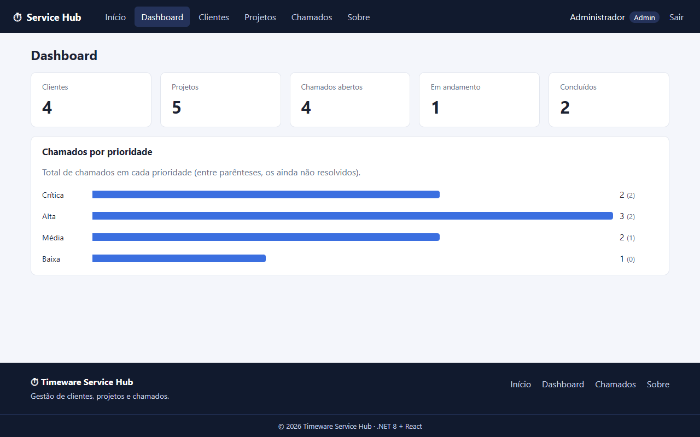
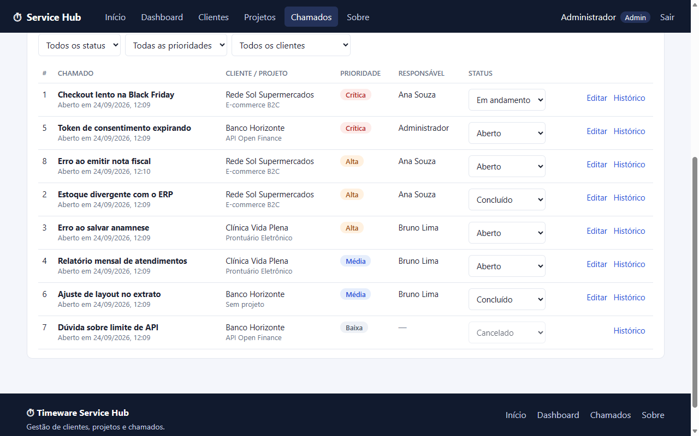
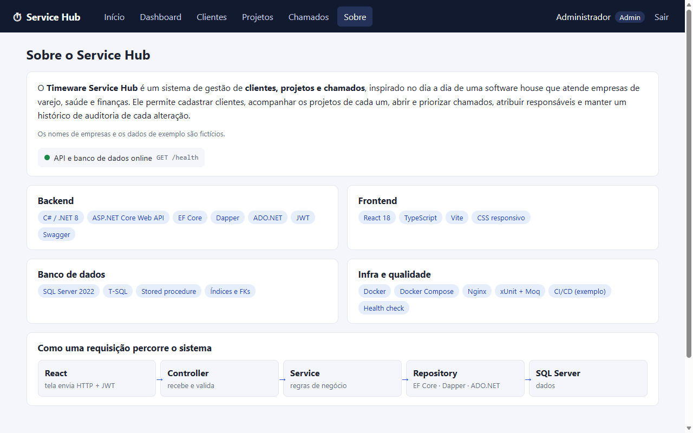
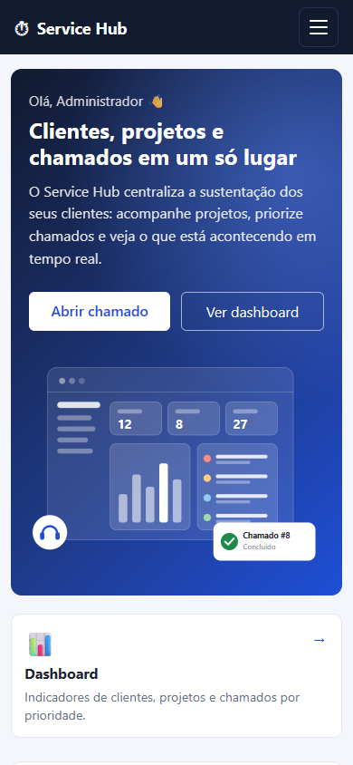
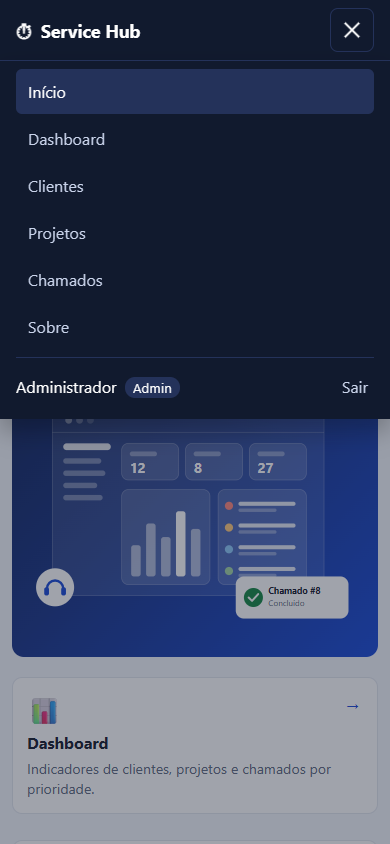
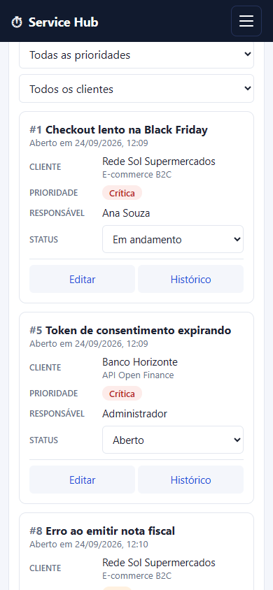

# Timeware Service Hub

Sistema web de **gestão de clientes, projetos e chamados** para empresas de serviços de tecnologia:
cadastro de clientes, acompanhamento de projetos, abertura e priorização de chamados, atribuição de
responsáveis, dashboard de indicadores e trilha de auditoria.




---

## Sumário

- [Funcionalidades](#funcionalidades)
- [Tecnologias](#tecnologias)
- [Arquitetura](#arquitetura)
- [Como executar](#como-executar)
- [API](#api)
- [Banco de dados](#banco-de-dados)
- [Testes](#testes)
- [CI/CD e deploy](#cicd-e-deploy)
- [Estrutura do projeto](#estrutura-do-projeto)
- [Screenshots](#screenshots)
- [Próximos passos](#próximos-passos)

---

## Funcionalidades

| Módulo | O que faz |
|---|---|
| **Autenticação** | Login com e-mail e senha (hash BCrypt), token **JWT** e autorização por perfil (Admin / Analista) |
| **Clientes** | Cadastro, listagem, busca, edição e exclusão. Documento (CNPJ/CPF) único; exclusão restrita a Admin e bloqueada quando o cliente possui projetos ou chamados |
| **Projetos** | Vinculados a um cliente, com status (Planejado, Em andamento, Pausado, Concluído) e responsável |
| **Chamados** | Abertura, prioridade (Baixa, Média, Alta, Crítica), atribuição de responsável, vínculo com cliente e projeto, mudança de status e filtros |
| **Dashboard** | Totais de clientes, projetos e chamados por status, e chamados por prioridade |
| **Auditoria** | Registro de criação, atualização e alteração de status, com histórico por chamado |
| **Interface** | Responsiva (desktop, tablet e celular), menu hambúrguer, notificações toast |
| **Operação** | Health check (`/health`), logging estruturado com Correlation ID, tratamento global de erros |

## Tecnologias

**Backend:** C# · .NET 8 · ASP.NET Core Web API · Entity Framework Core · Dapper · ADO.NET · JWT Bearer · BCrypt · Swagger/OpenAPI · Health Checks

**Banco de dados:** SQL Server 2022 · T-SQL · Stored Procedures

**Frontend:** React 18 · TypeScript · Vite · React Router · CSS

**Qualidade e infraestrutura:** xUnit · Moq · Docker · Docker Compose · Nginx · GitHub Actions · Azure Pipelines · Kubernetes

---

## Arquitetura

```
┌──────────────────────┐   HTTP/JSON + JWT   ┌────────────────────────────────────────┐        ┌──────────────┐
│ React + TypeScript   │ ──────────────────▶ │ ASP.NET Core Web API (.NET 8)          │  SQL   │ SQL Server   │
│ (Nginx)              │ ◀────────────────── │                                        │ ─────▶ │ 2022         │
└──────────────────────┘                     │ Middlewares (logging, erros, auth)     │        └──────────────┘
                                             │   → Controllers   (HTTP)               │
                                             │   → Services      (regras de negócio)  │
                                             │   → Repositories  (acesso a dados)     │
                                             │        EF Core · Dapper · ADO.NET      │
                                             └────────────────────────────────────────┘
```

A API é organizada em camadas com **injeção de dependência** e **DTOs** na fronteira HTTP:

- **Controllers**: recebem a requisição, validam o modelo e devolvem o status HTTP adequado.
- **Services**: concentram as regras de negócio e registram a auditoria.
- **Repositories**: isolam o acesso a dados.
- **Middlewares**: log de requisições com Correlation ID e tempo de resposta; tratamento global de exceções no formato **ProblemDetails** (RFC 7807).

### Estratégia de acesso a dados

Cada tecnologia foi usada onde traz mais vantagem:

| Tecnologia | Onde | Motivo |
|---|---|---|
| **EF Core** | CRUD de clientes e projetos, gravação de chamados, login | Produtividade, change tracking e consultas LINQ tipadas |
| **Dapper** | Listagem de chamados (JOIN de 4 tabelas com filtros opcionais) e dashboard (stored procedure com múltiplos result sets) | Controle total do SQL e desempenho em consultas de leitura |
| **ADO.NET** | Trilha de auditoria e inicialização do banco | Operações simples e de alto volume, sem overhead de mapeamento |

---

## Como executar

### Com Docker (recomendado)

Pré-requisito: [Docker Desktop](https://www.docker.com/products/docker-desktop/).

```bash
git clone https://github.com/SEU-USUARIO/NOME-DO-REPOSITORIO.git
cd NOME-DO-REPOSITORIO
docker compose up --build
```

| Serviço | Endereço |
|---|---|
| Aplicação web | http://localhost:3000 |
| Swagger (documentação da API) | http://localhost:5000/swagger |
| Health check | http://localhost:5000/health |
| SQL Server | `localhost,1433` |

Na primeira execução a API cria o banco, aplica o schema (`database/01-ddl.sql`) e carrega dados de exemplo.

**Usuários de demonstração**

| Perfil | E-mail | Senha |
|---|---|---|
| Admin | admin@servicehub.local | Admin@123 |
| Analista | ana@servicehub.local | Analista@123 |
| Analista | bruno@servicehub.local | Analista@123 |

Para parar: `docker compose down`. Para recriar o banco do zero: `docker compose down -v`.

### Execução local (desenvolvimento)

Pré-requisitos: [.NET 8 SDK](https://dotnet.microsoft.com/download/dotnet/8.0) e [Node.js 20+](https://nodejs.org/).

```bash
# 1. Banco de dados
docker compose up -d sqlserver

# 2. API  →  http://localhost:5000/swagger
cd backend/TimewareServiceHub.Api
dotnet run

# 3. Frontend  →  http://localhost:5173
cd frontend
npm install
npm run dev
```

O Vite encaminha as chamadas `/api` para a API na porta 5000.

### Configuração

As configurações ficam em `backend/TimewareServiceHub.Api/appsettings.json` e podem ser sobrescritas por
variáveis de ambiente (ex.: `ConnectionStrings__DefaultConnection`, `Jwt__Chave`).

| Chave | Descrição |
|---|---|
| `ConnectionStrings:DefaultConnection` | Conexão com o SQL Server |
| `Jwt:Issuer`, `Jwt:Audience`, `Jwt:Chave`, `Jwt:ExpiracaoMinutos` | Emissão e validação do token |
| `Cors:Origens` | Origens permitidas para o frontend |
| `Database:InicializarAoSubir` | Cria o schema e os dados de exemplo ao iniciar (desligar em produção) |

> As credenciais incluídas no repositório são apenas para ambiente local. Em produção devem vir de
> variáveis de ambiente ou de um cofre de segredos (Azure Key Vault / AWS Secrets Manager).

---

## API

Todos os endpoints, exceto login e health check, exigem o header `Authorization: Bearer <token>`.
A documentação interativa está no Swagger, e o arquivo
[`TimewareServiceHub.Api.http`](backend/TimewareServiceHub.Api/TimewareServiceHub.Api.http) traz requisições prontas.

| Método | Rota | Descrição |
|---|---|---|
| `POST` | `/api/auth/login` | Autentica e retorna o JWT |
| `GET` | `/api/usuarios` | Lista usuários ativos |
| `GET` | `/api/clientes?busca=` | Lista/busca clientes |
| `GET` | `/api/clientes/{id}` | Detalhe do cliente |
| `POST` | `/api/clientes` | Cria cliente |
| `PUT` | `/api/clientes/{id}` | Atualiza cliente |
| `DELETE` | `/api/clientes/{id}` | Exclui cliente (**Admin**) |
| `GET` | `/api/projetos?clienteId=` | Lista projetos |
| `GET` | `/api/projetos/{id}` | Detalhe do projeto |
| `POST` | `/api/projetos` | Cria projeto |
| `PATCH` | `/api/projetos/{id}/status` | Altera status do projeto |
| `GET` | `/api/chamados?status=&prioridade=&clienteId=&responsavelId=&busca=` | Lista chamados com filtros |
| `GET` | `/api/chamados/{id}` | Detalhe do chamado |
| `POST` | `/api/chamados` | Abre chamado |
| `PUT` | `/api/chamados/{id}` | Atualiza prioridade, responsável, projeto e texto |
| `PATCH` | `/api/chamados/{id}/status` | Altera status do chamado |
| `GET` | `/api/chamados/{id}/historico` | Histórico de auditoria |
| `GET` | `/api/dashboard` | Indicadores |
| `GET` | `/health` | Saúde da API e do banco |

**Respostas de erro** seguem o padrão ProblemDetails:

```json
{
  "title": "Regra de negócio violada",
  "status": 400,
  "detail": "O projeto informado não pertence ao cliente do chamado.",
  "instance": "/api/chamados",
  "traceId": "0HNOQ9NFUJAJK:00000001"
}
```

| Status | Quando |
|---|---|
| 400 | Dados inválidos ou regra de negócio violada |
| 401 | Token ausente, inválido ou expirado; credenciais incorretas |
| 403 | Usuário sem permissão (ex.: Analista excluindo cliente) |
| 404 | Recurso não encontrado |
| 500 | Erro inesperado (detalhes apenas no log, identificados pelo `traceId`) |

---

## Banco de dados

```
Usuarios ─┬─< Projetos >── Clientes
          │       │            │
          └─< Chamados >───────┘
                 (ProjetoId opcional)

Auditoria (Entidade, EntidadeId, Acao, Detalhes, UsuarioId, DataHora)
```

- Chaves primárias com `IDENTITY`, chaves estrangeiras sem exclusão em cascata, `UNIQUE` em e-mail e documento, `CHECK` nos domínios de status e prioridade.
- Índices nas colunas de chave estrangeira e índice composto `(Status, Prioridade)` para os filtros mais usados.
- Stored procedure `dbo.sp_ObterDashboard` com dois result sets.
- Datas armazenadas em UTC.

| Script | Conteúdo |
|---|---|
| [`database/01-ddl.sql`](database/01-ddl.sql) | Tabelas, constraints, índices e procedure (idempotente) |
| [`database/02-seed.sql`](database/02-seed.sql) | Dados de exemplo, em transação |
| [`database/00-create-database.sql`](database/00-create-database.sql) | Criação manual do banco |

---

## Testes

Testes unitários das regras de negócio do `ChamadoService` com **xUnit** e **Moq** (repositórios mockados):

```bash
cd backend
dotnet test
```

Sem o .NET SDK instalado, via Docker:

```bash
docker run --rm -v "${PWD}/backend:/src" -w /src mcr.microsoft.com/dotnet/sdk:8.0 dotnet test
```

---

## CI/CD e deploy

- **[GitHub Actions](.github/workflows/ci.yml)**: a cada push ou pull request na `main`, faz restore, build e testes do backend, build do frontend e build das imagens Docker.
- **[Azure Pipelines](azure-pipelines.yml)**: stage de build e testes, push da imagem para o Azure Container Registry e stage de deploy condicionado à branch `main`.
- **[Kubernetes](k8s/api.yaml)**: manifesto de referência com Deployment (3 réplicas, rolling update), Service, Secret e probes de readiness/liveness no `/health`.
- **Imagens Docker**: build multi-stage (SDK → runtime ASP.NET) executando com usuário não-root; frontend servido por Nginx com proxy reverso para a API.

---

## Estrutura do projeto

```
├── backend/
│   ├── TimewareServiceHub.sln
│   ├── TimewareServiceHub.Api/
│   │   ├── Controllers/          Endpoints HTTP
│   │   ├── Services/             Regras de negócio e emissão de JWT
│   │   ├── Repositories/         Acesso a dados (EF Core, Dapper, ADO.NET)
│   │   ├── Domain/               Entidades e enums
│   │   ├── DTOs/                 Contratos de entrada e saída
│   │   ├── Data/                 DbContext, fábrica de conexões, inicializador do banco
│   │   ├── Middleware/           Logging de requisições e tratamento de exceções
│   │   ├── Configuration/        Options e conversores
│   │   ├── Exceptions/           Exceções de domínio
│   │   ├── Extensions/           Extension methods
│   │   ├── Program.cs            Composição da aplicação e pipeline HTTP
│   │   └── Dockerfile
│   └── TimewareServiceHub.Tests/ Testes unitários
├── frontend/
│   ├── src/
│   │   ├── api/                  Cliente HTTP, serviços e tipos
│   │   ├── auth/                 Contexto de autenticação
│   │   ├── components/           Layout, rodapé, toasts, ilustração
│   │   ├── pages/                Home, Dashboard, Clientes, Projetos, Chamados, Sobre, Login
│   │   └── styles.css
│   ├── nginx.conf
│   └── Dockerfile
├── database/                     Scripts SQL (DDL e dados de exemplo)
├── k8s/                          Manifesto Kubernetes
├── .github/workflows/            Pipeline de CI
├── azure-pipelines.yml
└── docker-compose.yml
```

---

## Screenshots

| Dashboard | Chamados |
|---|---|
|  |  |

| Sobre (status da API ao vivo) |
|---|
|  |

**Mobile**

| Início | Menu | Chamados |
|---|---|---|
|  |  |  |

---

## Próximos passos

- Paginação nas listagens (`OFFSET/FETCH`)
- Auditoria na mesma transação da operação (ou padrão Outbox)
- Refresh token e armazenamento do token em cookie `HttpOnly`
- EF Core Migrations aplicadas pelo pipeline
- Testes de integração com banco real (Testcontainers)
- Observabilidade com OpenTelemetry (traces e métricas) e Application Insights
- Comentários nos chamados e anexos

---

## Autor

**SEU NOME** · [LinkedIn](https://www.linkedin.com/in/SEU-PERFIL) · [GitHub](https://github.com/SEU-USUARIO)

> Projeto independente de portfólio, sem vínculo oficial com a Timeware. Os nomes de empresas e os dados de exemplo são fictícios.
